# M2-12 QA box-browser sessions — 2026-10-15

> **Label (read first):** Automated agent play on the box with **software-render** (SwiftShader / CPU WebGL). Box load average during sessions was about **5–22**. These are **not human players**. **FPS is low-confidence** (box/software-render artefact; not a device claim).

| Field            | Value                                                                                             |
| ---------------- | ------------------------------------------------------------------------------------------------- |
| Tester           | hivesurge-qa (agent, Computer drag + Q queen)                                                     |
| Build            | main @ `21acf39`                                                                                  |
| Server           | `http://127.0.0.1:43565/?debug` (loopback only)                                                   |
| Fresh save       | Chrome Incognito (new window per session)                                                         |
| Protocol         | `research/m2-12-local-playtest-protocol.md` §2 (20-min cap; stopped earlier by 3-loss stuck rule) |
| Analytics export | Not done (localStorage not inspected)                                                             |
| Screenshots      | `playtests/m2-12/qa/img/` (12 key frames)                                                         |
| Raw notes        | `/tmp/qa-m2-12/notes.md` (session scratch; not in repo)                                           |

## Headline

| Session | Outcome                                                                                                                | Time to first win | Drop-off         | Ads / offers |
| ------- | ---------------------------------------------------------------------------------------------------------------------- | ----------------- | ---------------- | ------------ |
| S1      | L1 lost ×3 (nest 98%, 80%, 38%). No win.                                                                               | —                 | L1 Meadow Start  | None seen    |
| S2      | L1 lost ×3 (nest 21%, 31%, 37%); 21–32 bees unfired at timeout. No win.                                                | —                 | L1 Meadow Start  | None seen    |
| S3      | L1 lost once (8%), then **won 3★** with 4 s left (first win at **192 s**). L2 Dandelion Drift lost ×3 (99%, 98%, 82%). | 192 s (L1)        | **L2** at ~390 s | None seen    |

Defeat screens offered only **Retry (free)** and **Home** (coins). No ad, shop prompt, or revive offer in battle.

### FPS (low-confidence)

Overlay samples from battle screenshots (sparse, not 1 Hz sampling). Renderer showed `low@floor (auto)`, `dpr 0.50`.

| Session | Instantaneous (approx) | Overlay median (typ) | Overlay 1% low (typ) | Load avg (start → later) |
| ------- | ---------------------- | -------------------- | -------------------- | ------------------------ |
| S1      | 11–29                  | ~15–16 (med 12–30)   | ~5–7 (2.5–20)        | ~5–8                     |
| S2      | 13–27                  | ~22 (med 15–30)      | ~5–12 (2–15)         | ~11–12                   |
| S3      | —                      | ~12–15 (med 8.6–20)  | ~5–6 (1.7–7.5)       | ~11 → 18.5 (peak ~22)    |

**Overall:** median about **12–22**, 1% low about **5**. Do not use for M2-19a device gates.

## Sessions

### S1 — L1 stuck (3 losses)

- Tutorial auto-started on L1: Hold and drag → Drag to the x2 gate → Aim ahead → Tap the queen → Smash the nest.
- Attempt 1: LOSS, nest **98%**, ~90 s, reward 1 coin. Early drags fired 1–4 bees; learned hold-on-cannon charges (~36–51 bees / 3 s).
- Attempt 2: LOSS, nest **80%**, reward 4 coins.
- Attempt 3: LOSS "So close!", nest **38%**, reward 12 coins. Queen tapped once (tutorial hint).
- Stopped after 3 straight L1 failures.

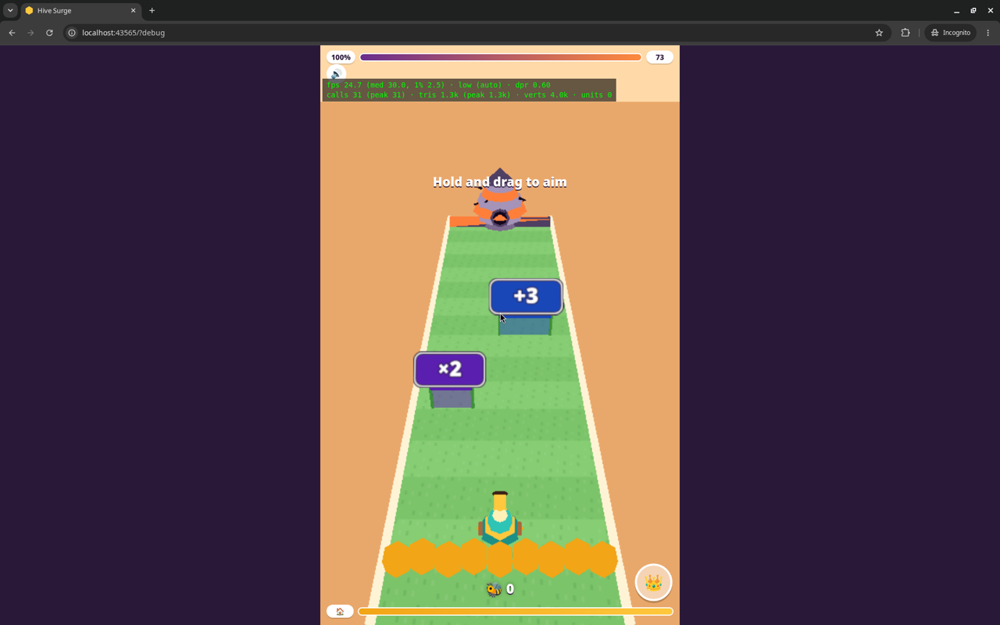
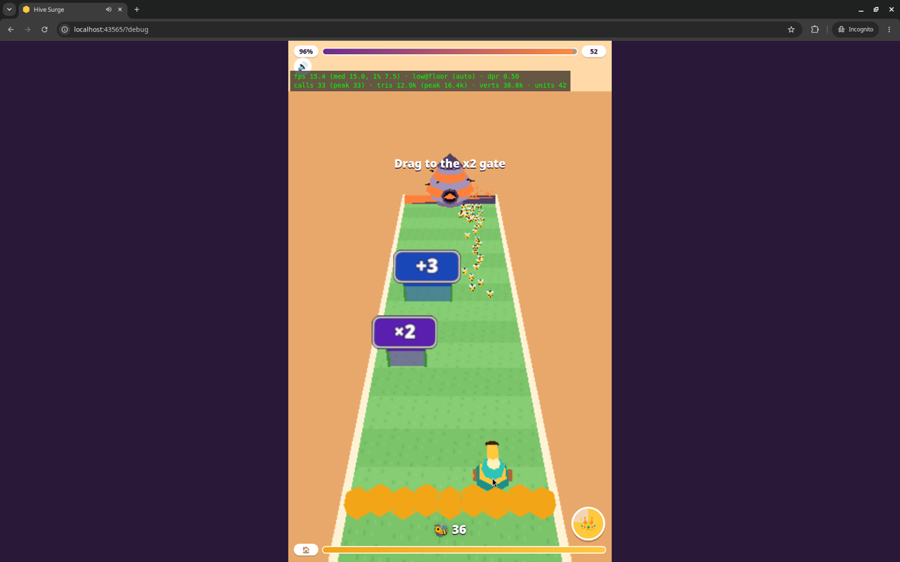
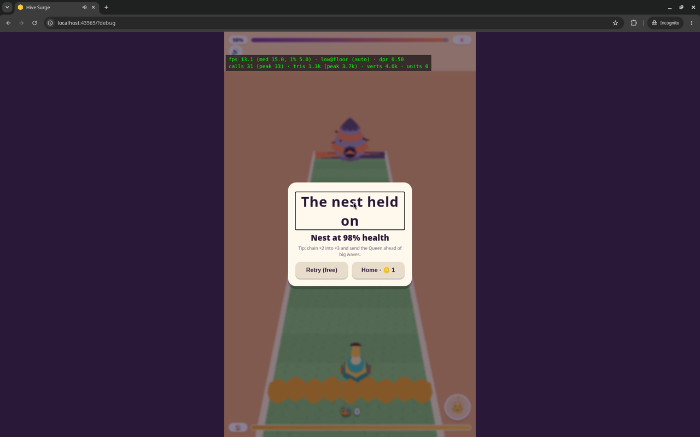
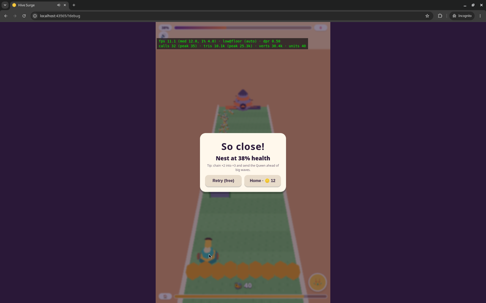

### S2 — L1 stuck again; stuck tutorial hint

- Fresh Incognito; tutorial auto-started.
- Mechanic: press-hold sets aim (cannon faces pointer); ~3 s hold → ~30–110 bees; release fires. Short drag → 1–2 bees.
- Attempt 1: LOSS "So close!", nest **21%**, **31 bees unfired**, 16 coins.
- Attempt 2: LOSS, nest **31%**, **32 bees unfired**, 14 coins. Queen once.
- Attempt 3: LOSS, nest **37%**, 13 coins. Queen early + mid.
- **[major]** Tutorial hint **"Drag to the x2 gate"** stayed on screen for the whole of attempts 2 and 3 (advanced in attempt 1 / S1 a3).
- Session ~275 s (~4 min). Stopped after 3 L1 failures.

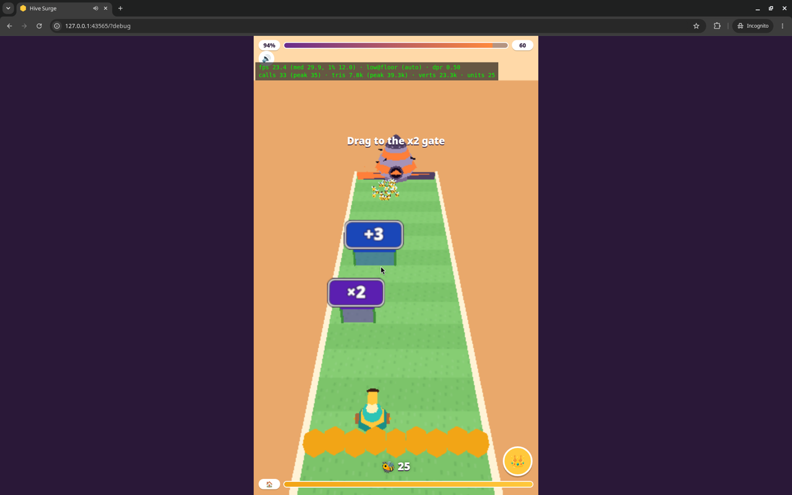
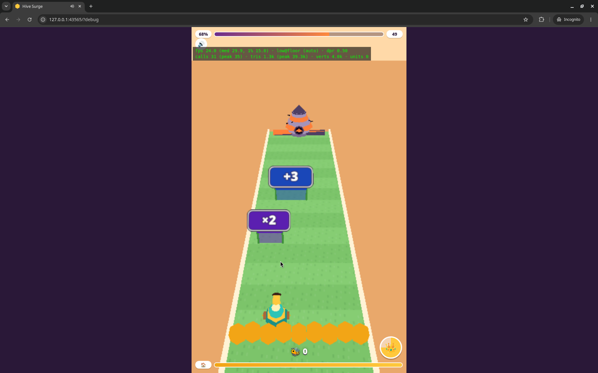

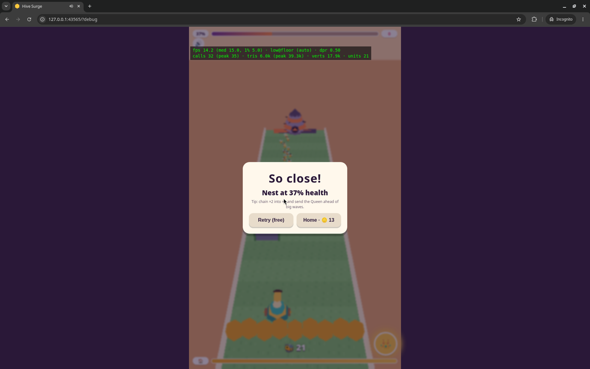

### S3 — First win, then L2 drop-off

- Attempt 1 L1: LOSS "So close!", nest **8%**, ~101 s, 19 coins.
- Attempt 2 L1: **WIN** "Nest broken!", **3 stars**, +82 coins, peak swarm 98, **4 s left**. Time to first win from session start: **192 s**.
- L2 Dandelion Drift (trap gates −600 / −5xx, +2 / x2):
  - A1: LOSS "The nest held on", nest **99%**, 0 coins. 3 s holds → **6–19 bees** (vs 40–110 on L1); nest −1–2% per volley.
  - A2: LOSS, nest **98%**.
  - A3: LOSS, nest **82%** (aimed +2; queen ×2).
- Stopped after 3 L2 failures. Session end **390 s** (~6.5 min). Home coins: 4.

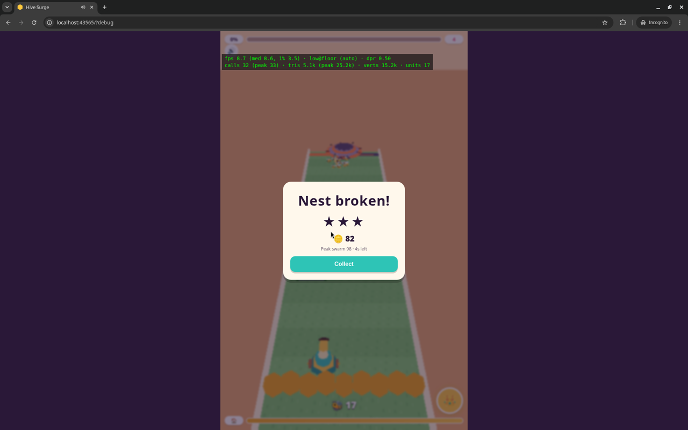
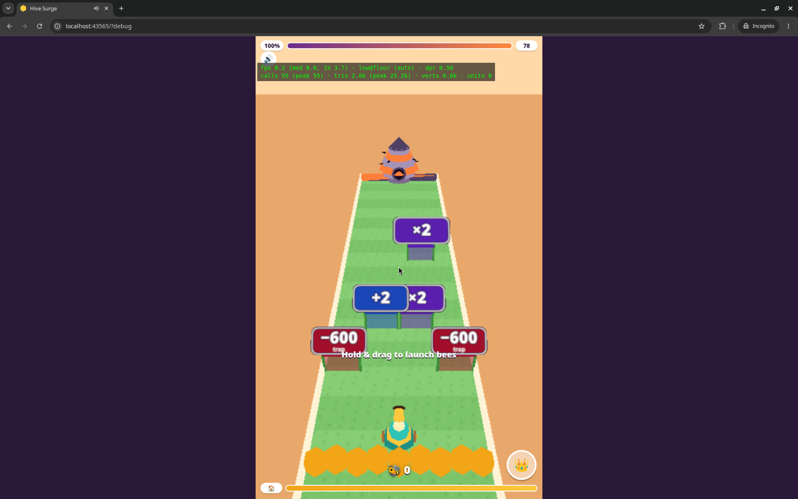
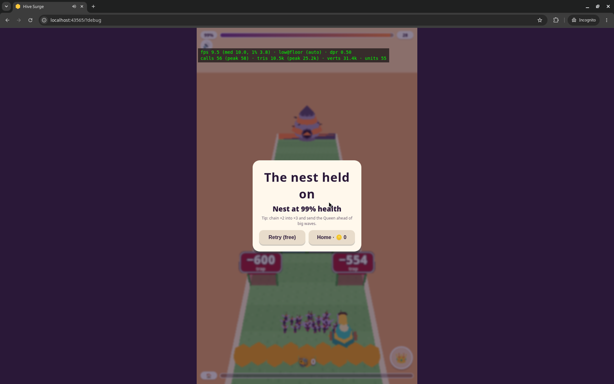
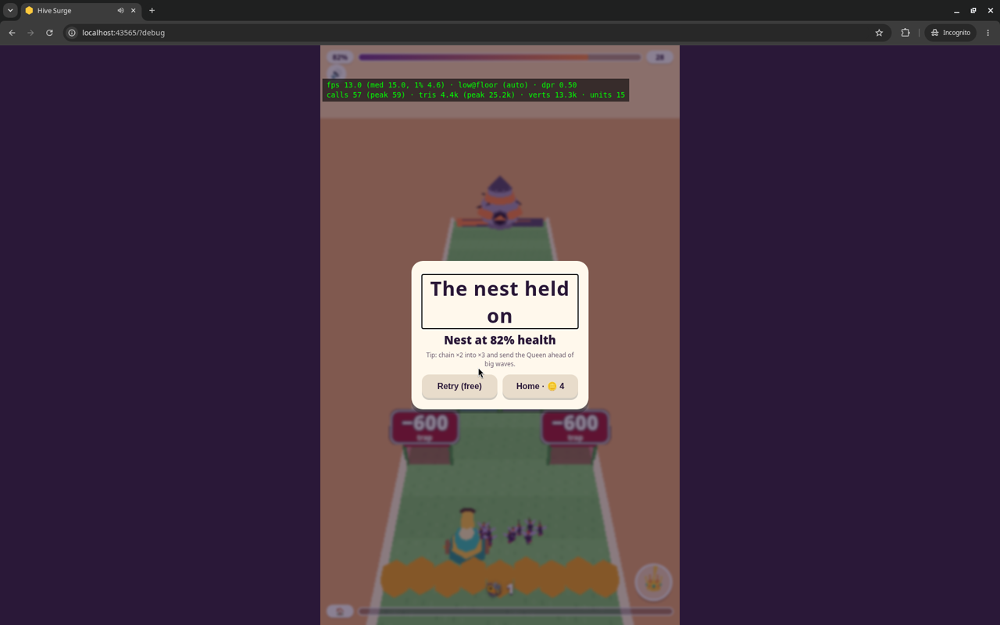

## Bugs and design findings

### Major

1. **Stuck tutorial hint (S2 a2–a3):** "Drag to the x2 gate" never advances for the whole attempt.
2. **L1 missed-gate feedback:** no feedback on a missed gate; charged volley often goes straight up past the x2/+3 gates.
3. **L2 difficulty spike:** same 3 s hold yields 6–19 bees vs 40–110 on L1; nest drops only ~1–2% per volley; 3 straight losses after the first L1 win.
4. **L2 trap gates unexplained:** −600 / −550..−580 values change mid-level with no teaching.

### Minor

5. Fail tips do not teach gate chaining or queen use; queen button state (grey vs active) is unclear.
6. Hold / "Hold & drag" hint repeats every retry.
7. No aim preview before / during hold.

### Polish / environment

8. FPS low on this box (software GL + high load) — **not representative**; track separately from gameplay bugs.

## Method notes

- Driver: Computer tool (drag-with-path = hold+drag, key `q` = queen). Browser automation tools cannot see Incognito windows.
- `[::1]` refused (server bound to `127.0.0.1` only).
- §4 bot and §5 human protocol sections not run (out of scope of this request).
- Stuck rule: 3 straight losses on the same level → stop session (matches brief).

## Pointer

Short copy for research: `research/m2-12-qa-sessions.md`.
